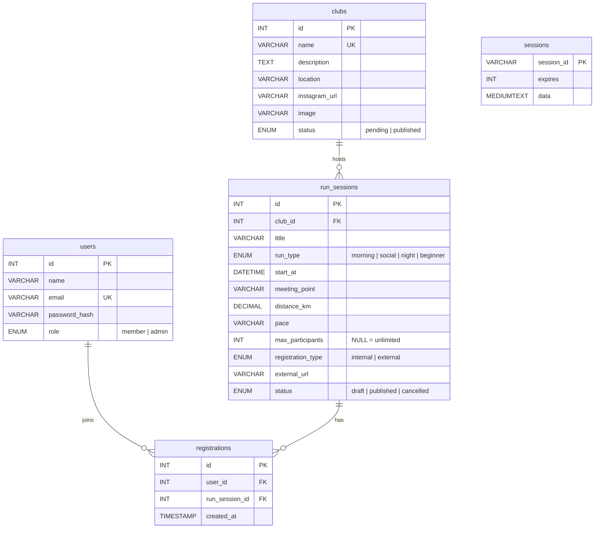

# RUN BKK — Database

## ER Diagram

(เปิดดูเป็นภาพได้ใน GitHub หรือ VS Code Markdown Preview ที่รองรับ Mermaid)



`sessions` ไม่มีความสัมพันธ์กับตารางอื่น — เป็นที่เก็บ login session ของ express-mysql-session

## ผู้ใช้ 2 แบบ (role)

| role | ทำอะไรได้ |
|---|---|
| `member` | ดูคลับ/กิจกรรม, ค้นหา, Join / Cancel, My Runs, แก้ Profile |
| `admin` | ทุกอย่างของ member + กรอก/แก้ข้อมูลคลับและกิจกรรม, ดูรายชื่อผู้เข้าร่วม, จัดการผู้ใช้ |

ข้อมูลคลับและกิจกรรมมี Admin เป็นคนกรอกเพียงคนเดียว (ตรวจสอบข้อมูลจากแหล่งจริงก่อนกรอก)

## ความสัมพันธ์ (Relationships)

| ความสัมพันธ์ | แบบ | อธิบาย |
|---|---|---|
| clubs → run_sessions | 1 : N | 1 คลับมีหลายกิจกรรม |
| users ↔ run_sessions | M : N | ผ่านตารางกลาง `registrations` |

## Constraint สำคัญ

- `users.email` **UNIQUE** → สมัครอีเมลซ้ำไม่ได้
- `registrations (user_id, run_session_id)` **UNIQUE** → Join กิจกรรมเดิมซ้ำไม่ได้
- `ON DELETE CASCADE` → ลบคลับแล้วกิจกรรม/การลงทะเบียนหายตาม
- `ON DELETE CASCADE` (registrations.user_id) → ลบผู้ใช้แล้วการ Join ของเขาหายตาม
- `status` → หน้าเว็บแสดงเฉพาะ `published` ข้อมูลที่ยังไม่ยืนยันเป็น `pending` / `draft`

## วิธีติดตั้ง DB

1. สร้างฐานข้อมูลและ user (ทำครั้งเดียว ด้วยบัญชี admin ของ MariaDB/MySQL)
   ```sql
   CREATE DATABASE runbkk CHARACTER SET utf8mb4 COLLATE utf8mb4_unicode_ci;
   CREATE USER 'runbkk_app'@'localhost' IDENTIFIED BY 'รหัสผ่าน';
   GRANT ALL PRIVILEGES ON runbkk.* TO 'runbkk_app'@'localhost';
   ```
2. คัดลอก `.env.example` เป็น `.env` แล้วใส่รหัสผ่าน
3. สร้างตาราง + ข้อมูลเริ่มต้น
   ```bash
   npm run db:setup
   ```
   ถ้าใน DB มีตารางอยู่แล้ว สคริปต์จะ**หยุด**และแสดงจำนวนข้อมูลที่จะหาย
   ถ้าต้องการล้างแล้วสร้างใหม่จริงๆ (⚠️ ข้อมูลเดิมหายทั้งหมด):
   ```bash
   npm run db:setup -- --force
   ```

## กรอก / แก้ข้อมูลด้วย DBeaver

เชื่อมต่อ: New Database Connection → **MariaDB** (หรือ MySQL) →
Host `127.0.0.1` · Port `3306` · Database `runbkk` · Username `runbkk_app` · Password จาก `.env`

กติกา:
- ไม่สร้าง/แก้โครงสร้างตารางใน DBeaver — แก้ที่ `runbkk.sql` แทน (โค้ดต้องแก้ตาม)
- ไม่เพิ่ม user ในตาราง `users` ด้วยมือ (รหัสต้องเป็น bcrypt) → สมัครผ่านเว็บ แล้วค่อยแก้ `role`
- `run_sessions.status` ต้องเป็น `published` ถึงจะแสดงบนเว็บ / ข้อมูลที่ยังไม่ยืนยันใช้ `draft`
- `start_at` เป็นเวลาไทย รูปแบบ `2026-11-22 06:00:00`
- กรอกเสร็จ → export ข้อมูลไปไว้ใน `seed.sql` เพื่อให้ตอน deploy มีข้อมูลเดียวกัน
