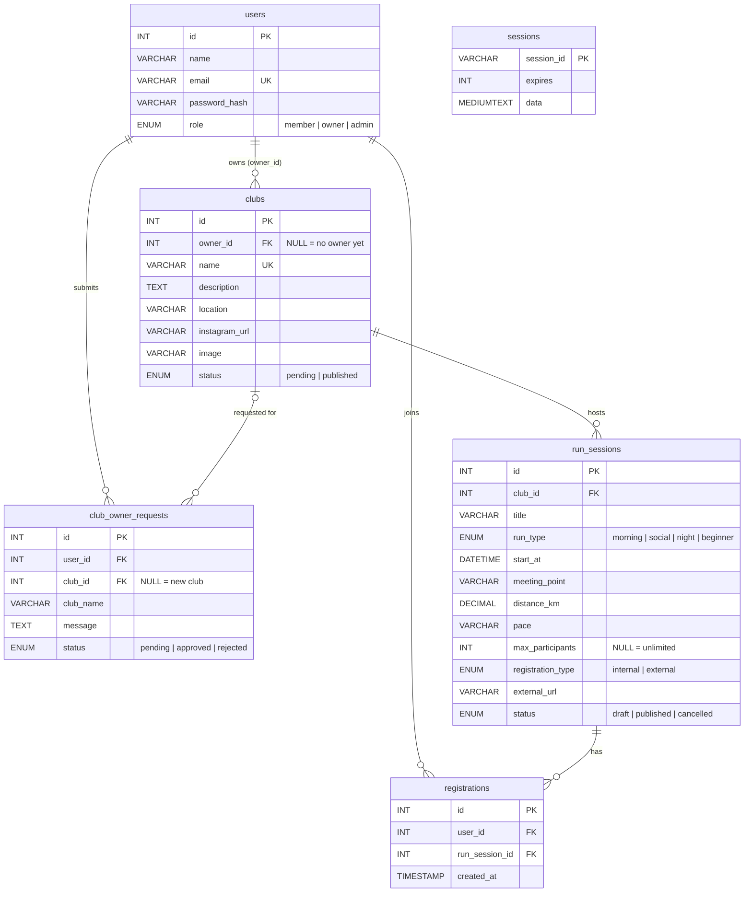

# RUN BKK — Database

## ER Diagram

(เปิดดูเป็นภาพได้ใน GitHub หรือ VS Code Markdown Preview ที่รองรับ Mermaid)



`sessions` ไม่มีความสัมพันธ์กับตารางอื่น — เป็นที่เก็บ login session ของ express-mysql-session

## ความสัมพันธ์ (Relationships)

| ความสัมพันธ์ | แบบ | อธิบาย |
|---|---|---|
| users → clubs | 1 : N | 1 owner ดูแลได้หลายคลับ / คลับอาจยังไม่มี owner (NULL) |
| clubs → run_sessions | 1 : N | 1 คลับมีหลายกิจกรรม |
| users ↔ run_sessions | M : N | ผ่านตารางกลาง `registrations` |
| users → club_owner_requests | 1 : N | 1 user ส่งคำขอได้หลายครั้ง |

## Constraint สำคัญ

- `users.email` **UNIQUE** → สมัครอีเมลซ้ำไม่ได้
- `registrations (user_id, run_session_id)` **UNIQUE** → Join กิจกรรมเดิมซ้ำไม่ได้
- `ON DELETE CASCADE` → ลบคลับแล้วกิจกรรม/การลงทะเบียนหายตาม
- `ON DELETE SET NULL` → ลบ user ที่เป็น owner แล้วคลับยังอยู่
- `status` → หน้าเว็บแสดงเฉพาะ `published` ข้อมูลที่ยังไม่ยืนยันเป็น `pending` / `draft`

## วิธีติดตั้ง DB

1. สร้างฐานข้อมูลและ user (ทำครั้งเดียว ด้วยบัญชี admin ของ MariaDB/MySQL)
   ```sql
   CREATE DATABASE runbkk CHARACTER SET utf8mb4 COLLATE utf8mb4_unicode_ci;
   CREATE USER 'runbkk_app'@'localhost' IDENTIFIED BY 'รหัสผ่าน';
   GRANT ALL PRIVILEGES ON runbkk.* TO 'runbkk_app'@'localhost';
   ```
2. คัดลอก `.env.example` เป็น `.env` แล้วใส่รหัสผ่าน
3. สร้างตาราง + ข้อมูลเริ่มต้น (⚠️ ลบข้อมูลเดิมทั้งหมด)
   ```bash
   npm run db:setup
   ```
